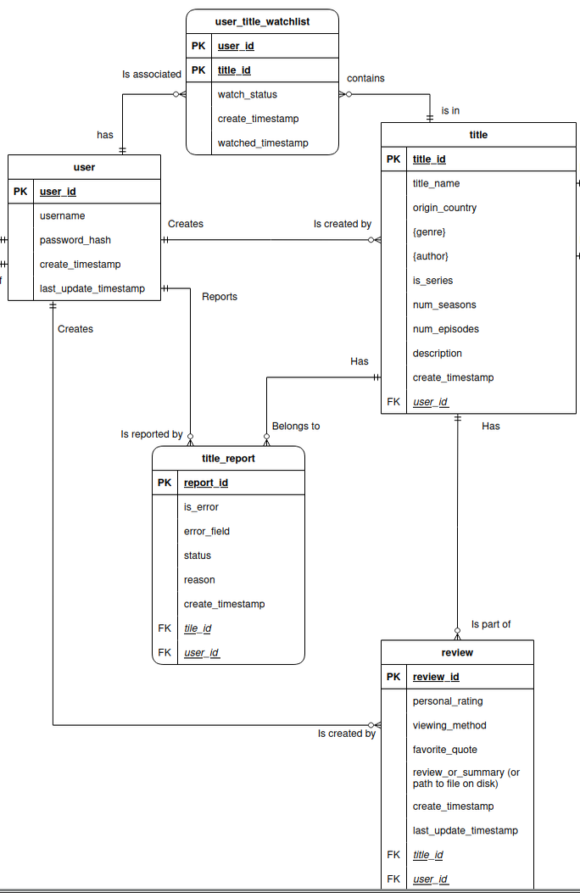
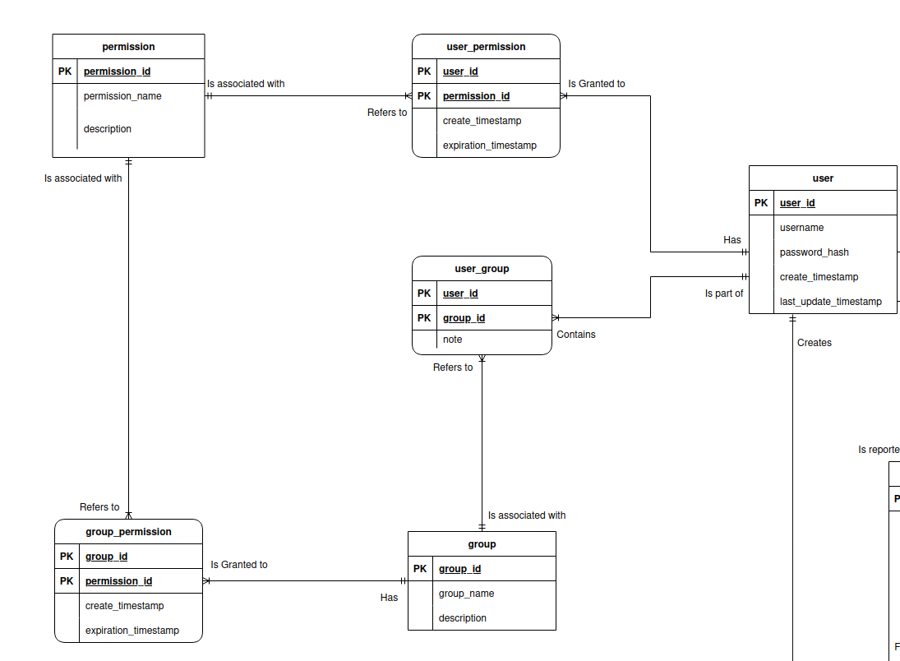
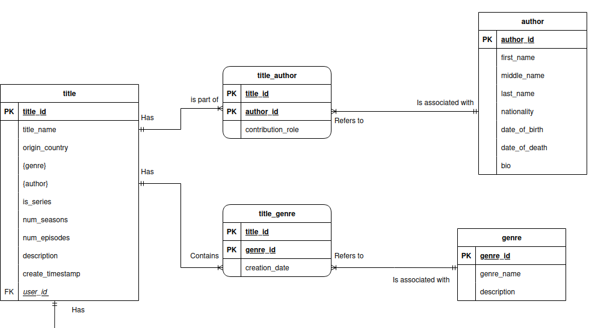

# Media Archive

We live in a time when there is a vast amount of media scattered across streaming services, which makes it difficult to pick something to watch when you don't know what to watch. Additionally, because we have what seems like endless options readily available to us, we often consume media so fast that we don't give ourselves time to internalize what we just watched, resulting in a fuzzy memory of the details years later. This application aims to solve the problem of media choice paralysis and forgetfulness in the modern era.

The idea is to provide a private and personalized space where users can curate a list of movies or shows they intend to watch and keep a record of what they have already seen, rather than relying on the 'My List' feature across different streaming services.

The intended users are binge-watchers, movie and television enthusiasts, or anyone who just wants an organized way to keep track of their media consumption. 

## Users will be able to:

- Register and log in 
- View a list of all movies or series they have on their watchlist, with options to filter it by watch status, genre, etc.
- Add a movie or series to their watchlist (including details like title, genre, personal review, favorite quotes, and where it was watched).
- Change a movie or series from "Plan to Watch" to "Watched", or update other details.
- Delete a movie or series from the watchlist.

## Database Design, Business Rules, and ERD

At the heart of this database are three main entities `user`, `title`, and `review`. The `user` and `title` entities are linked via several associative entities to manage complex relationships.

### Entities

Main entities:
  - `user`
  - `title`
  - `review`

Entities associated with `user`:
  - `user_permission`
  - `user_group`
  - `group_permission`
  - `permission`
  - `group`

Entities associated with `title`:
  - `title_author`
  - `title_genre`
  - `genre`
  - `author`

Entities associated with `title` and `user`:
  - `user_title_watchlist`
  - `title_report`

### Components of The Design

There are three main components to this database design.

#### Component I: The Main Entities

The following diagram shows the core relationship between users, the media they consume, and the feedback they provide through reviews and reports. 

#### Component II: User and Group Permissions

This diagram shows the authorization part for the system, showing how users can be organized into groups and assigned specific permissions to manage administrative, moderator, and user roles.

#### Component III: Genre and Author of a Title

This part of the ERD focuses on the metadata of a title, specifically the relationship between movies/shows, their creators, and their genres.

### Complete ERD and Business Rules

Business rules:

  - A `user` may create many `title`s. A `title` is created by exactly one `user`. 
  - A `user` may create many `review`s. A `review` is written by exactly one `user`.
  - A `user` must have one or many `permission`s. A `permission` is granted to one or more `user`s (associative relation).
  - A `user` must be part of one or many `group`s. A `group` must contain one or many `user`s (associative relation).
  - A `user` may add many `title`s to their `user_title_watchlist`. A `title` may appear on many `user_title_watchlist`s (associative relation).
  - A `user` may report many `title`s via `title_report`. A `title` may be reported by many `user`s (associative relation).

  - A `title` must have one or many `author`s. An `author` must be associated with one or many `title`s (associative relation).
  - A `title` must be part of one or many `genre`s. A `genre` must be associated with one or many `title`s (associative relation).
  - A `title` may have many `review`s. A `review` is part of exactly one `title`. 

The final Entity Relation Diagram (ERD) illustrates the entire database design

### Database Normalization

This database is in first normal form (1NF) because:
  * Each entity has a unique identifier, thus all rows for each entity will be unique.
  * Each cell in each row within each entity only holds a singe value.
  * Each cell in each row within each entity has a value that cannot be decomposed further.

This database is also in second normal form (2NF) because:
  * Its is in in 1NF and,
  * All non-key attributes are fully dependent on the primary key(s), there are no partial dependencies.

Additionally, this database is also in third normal form (3NF) because:
  * It is in 2NF and,
  * There are no non-key attributes that depend on other non-key attributes that together depend on the key(s) (there are no transitive dependencies, all attributes depend on the key(s) and only the key(s)).
